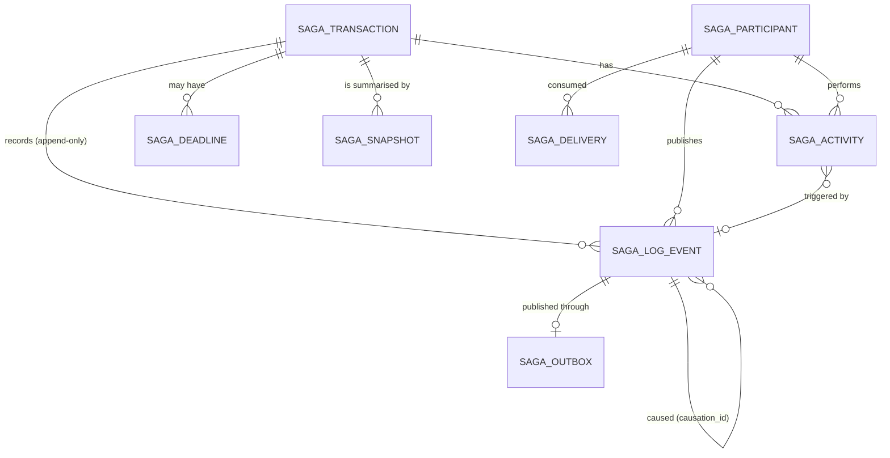

# ADR-041: Unified Saga Log — one OLTP model for orchestration and choreography

## Status

**Accepted** — 2026-11-18 | Target: v2.1.0 | Milestone: "v2.1.0: Unified Saga Log"

Prerequisite of the Fluss/Iceberg analytics (ADR-013, now v2.2.0): the log this ADR
introduces is what gets streamed and tiered.

## Context

Sagaz has three data models for the same idea, a distributed transaction:

| Coordination | Where its state lives today |
|---|---|
| Orchestrated (`Saga`) | `sagas` + `saga_steps`: mutable current state. `saga_events` + `saga_event_snapshots` only when event sourcing is enabled (ADR-033). `saga_snapshots` + `saga_replay_log` for replay (ADR-024) |
| Choreographed (`ChoreographedSaga`) | Participant memory in `choreography_actions`, `choreography_transactions`, `choreography_deliveries` and `choreography_deadlines`. The transaction status is a JSON blob in a fake `sagas` row (`saga_name = 'choreography'`) written by the tracker. The events themselves only travel on the bus and are never stored |
| Both | Deduplication twice: `consumer_inbox` (outbox consumers) and `choreography_deliveries` |

The consequences:

- **No common history.** An orchestrated saga has a log only with event sourcing; a
  choreographed one has none. Auditing, replay and time travel work for one kind
  only.
- **Hidden state.** The choreography status is JSON inside a row whose columns lie
  (no steps, a synthetic status). Analytics had to special-case it (v2.0.1, #459), and
  before that it showed a phantom saga.
- **No atomic "record and publish" in choreography.** A participant updates its state
  and publishes an event in two steps. A crash in between loses one of them.
- **Duplicate concepts:** two inboxes, two places for per-transaction memory, and
  three snapshot tables.

The literature on sagas (Garcia-Molina & Salem; McCaffrey's "distributed sagas")
places the unity of a saga in a durable **saga log**, not in a process. Orchestration
and choreography differ in who decides the next step, not in what must be recorded.

## Decision

Introduce a **unified saga log**, one OLTP model both coordination styles write to,
in a database that the services of an organization **may share**.

### Model

All tables carry `tenant_id` and the tenant RLS policy (ADR-020).

| Table | Key | Purpose |
|---|---|---|
| `saga_transaction` | `(tenant_id, transaction_id)` | One distributed transaction. `transaction_id` is the saga id or the correlation id. Columns: `flow` (saga name, or the first business event type), `coordination` (`orchestrated` \| `choreographed`), `status`, `initiator` (participant), `started_at`, `ended_at`, `context` (orchestrated only), `version` (optimistic concurrency) |
| `saga_activity` | `(tenant_id, transaction_id, activity_id)` | One unit of work by one participant: an orchestrated step, or a choreography handler that has a compensation. Columns: `participant`, `name` (step, or handled event type), `status` (`executing`, `completed`, `failed`, `compensated`, `compensation_failed`), `attempt`, `region` (ADR-034), `triggered_by` (event id), `result`, `error`, timings. Replaces `saga_steps` and `choreography_actions` |
| `saga_log_event` | `(tenant_id, transaction_id, sequence)`, unique `event_id` | **The log**: append-only, numbered per transaction. `event_type`, `kind` (`lifecycle` \| `business` \| `compensate` \| `compensated`), `source` (participant), `causation_id`, `payload`, `occurred_at`, `event_version`. Holds the ADR-033 lifecycle events of orchestrated sagas and every choreography event. Replaces `saga_events` and the events inside the tracker's JSON |
| `saga_snapshot` | `(tenant_id, transaction_id, sequence)` | Projection snapshots (ADR-033) and replay snapshots (ADR-024), with a `kind` column. Replaces `saga_event_snapshots` and `saga_snapshots` |
| `saga_participant` | `(tenant_id, name)` | The services taking part: `name`, `region`, `owner` (team), and the database role they write as |
| `saga_delivery` | `(tenant_id, participant, event_id)` | What each participant consumed: deduplication and audit. Replaces `choreography_deliveries` and `consumer_inbox` |
| `saga_deadline` | `(tenant_id, transaction_id, owner)` | Time limits and their leases (#449). Replaces `choreography_deadlines` |
| `saga_outbox` | unchanged | Gains `log_event_id`, so a published message points at its log entry |

The tracker's status, the orchestrated saga's current state and the analytics Silver
layer all become **projections** of these tables. They are no longer stored as JSON.

### Writing rules

1. **One writer per fact.**
   - **Log events:** each event is appended by the participant that publishes it.
   - **Lifecycle events:** an orchestrated saga's lifecycle events are appended by its
     coordinator.
   - **The transaction row:** it is inserted by its initiator. Its `status` is updated
     only through `version`-checked transitions that follow the log.
2. **Record and publish atomically.** A participant appends its event, updates its
   activity and inserts the outbox row in **one database transaction**. The outbox relay
   (or CDC, ADR-011) publishes afterwards. This closes the crash window that
   choreography has today.
3. **Order:** `sequence` is assigned per transaction under an advisory lock, as the
   ADR-033 store does. Bus delivery order then matters less, because readers can sort
   by `sequence`.
4. **The log is append-only:** service roles get `INSERT` and `SELECT` on
   `saga_log_event`, never `UPDATE` or `DELETE`. Retention is an operator job, and
   ADR-013 tiers the log to Iceberg.

### Sharing the database between microservices

"Database per service" holds for **domain data**. This database holds **coordination
state**, as the stores of Temporal, Camunda or Axon Server do. A service's orders,
payments or stock stay in its own database. What is shared is the record of the
transactions they take part in. Sharing is optional: a single service can keep its
own saga database as today.

Isolation with a shared database:

- **One role per service**, recorded in `saga_participant`. Sessions set
  `app.participant` next to `app.tenant_id`.
- **Write isolation (RLS):** a service writes only rows whose
  `participant` / `source` / `owner` is its own, in its tenant. It cannot change
  another service's activities or deliveries, nor append events in its name.
- **Read scope:** a service reads the transactions it takes part in. The tracker,
  analytics and operator roles read everything in their tenants, or in the system
  scope.
- **Schema ownership** belongs to the platform (sagaz migrations), not to any service.
  Services depend on the sagaz version, not on each other's schemas.

The costs are a shared failure domain (mitigated by HA PostgreSQL) and a shared
schema version (mitigated by additive migrations and the `event_version` column).
Teams that cannot accept these keep a database per service. Choreography still works
across them through the bus, but then nothing gives a cross-service view, which is
the trade-off ADR-029 already documents.

### Backends

PostgreSQL is the reference, with RLS and advisory locks. SQLite implements the same
model for development and tests, with no RLS. The in-memory backend implements it for
unit tests. Redis does not implement the log: Redis users keep the current snapshot
storage.

## Migration

Additive first, removal later:

| Phase | Version | What |
|---|---|---|
| 1 | v2.1.0 | Schema and repositories for the new tables (PostgreSQL, SQLite, memory), RLS per tenant and participant, `sagaz migrate` to copy existing rows |
| 2 | v2.1.0 | Orchestrated engines (`sagaz.Saga`, `sagaz.core.saga.Saga`) write the log, activities and transaction (opt-in `storage_layout = "unified"`). The ADR-033 event store becomes a view on `saga_log_event` |
| 3 | v2.1.0 | Choreography writes the log atomically with the outbox. The tracker becomes a projection. Participant state moves to `saga_activity` / `saga_delivery` / `saga_deadline` |
| 4 | v2.1.0 | Analytics reads the unified tables. The Silver/Gold layer of #459 stays, and its Bronze extraction is replaced |
| 5 | v3.0.0 | `unified` becomes the default; the old tables and the tracker's JSON records are removed |

Until phase 5, the old layout keeps working unchanged, and `sagaz migrate` converts a
database in place.

## Consequences

**Positive**
- One history for every saga: audit, replay and time travel work for both styles.
- Choreography gets atomic record-and-publish and a real cross-service view.
- Analytics and Fluss (ADR-013) read one typed log instead of blobs.
- Fewer tables and concepts: one inbox, one snapshot table, one deadline table.

**Negative**
- A larger migration, and two layouts to maintain until v3.0.0.
- A shared database is a shared failure domain and needs per-service roles and
  policies to be configured.
- Writing the log on every step adds a write per step for orchestrated sagas that did
  not use event sourcing. This must be benchmarked and kept within the ADR-033 budget.

## Alternatives considered

- **Keep separate models and unify only in analytics (#459):** this cannot give
  atomic record-and-publish or a cross-service log, and it keeps blobs in the OLTP side.
- **Event store only (no transaction or activity tables):** pure event sourcing. Every
  read becomes a projection, which hurts the CLI, monitor and claim queries (deadlines,
  outbox). The typed current-state tables are kept as projections maintained in the
  same transaction.
- **A shared database with no participant isolation:** simpler, but any service could
  rewrite another's history. Rejected.

## References

- ADR-016 (unified storage layer), ADR-020 (multi-tenancy), ADR-024 (replay),
  ADR-029 (choreography), ADR-033 (event sourcing), ADR-011 (CDC), ADR-013 (Fluss).
- Garcia-Molina & Salem, *Sagas* (1987); C. McCaffrey, *Distributed Sagas* (2015/2017).
- Issues #446–#449 (choreography guarantees), #459 (choreography analytics).
