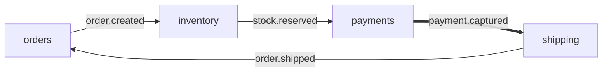

# Order fulfilment, choreographed

Four services fulfil an order without anyone in charge: `orders` announces it,
`inventory` reserves the stock, `payments` captures the money, `shipping` sends the
parcel. Each reacts to the previous one's event.



The example runs three orders, one for each way a transaction can end.

| Order | What happens | It ends |
|---|---|---|
| `o-1` | Everything works | `completed` |
| `o-2` | The card is declined | `rolled_back`: the stock is released |
| `o-3` | No carrier serves the address, after the payment was captured | `partially_committed`: the stock stays reserved |

## Run it

Save the [source](#the-source) as `order_fulfilment.py` and run `python order_fulfilment.py`:

```text
--8<-- "docs/examples/code/order_fulfilment.out"
```

## What to look at

**Each service is a class that knows only its own events.** `Inventory` handles
`order.created` and emits `stock.reserved`; it never mentions payments. `emits=`
declares what a handler publishes, which is what a
[diagram](../tour/choreography-pivots-and-diagrams.md#a-diagram-of-the-choreography) is drawn from.

**Undoing is local too.** `Inventory.release` is the compensation of what `reserve` did.
For `o-2` the engine asks every participant to compensate, and inventory puts the book
back: the stock ends at 4 books, one sold to `o-1`.

**The payment is a pivot.** `@on_event("stock.reserved", pivot=True)` says a captured
payment is not taken back. So for `o-3`, where shipping fails *after* it, inventory
keeps its reservation: releasing the lamp would contradict a payment that stands. The
report says `inventory kept ['order.created']`, and the stock of lamps ends at 0.

**Retries differ per handler.** `capture` has `max_retries=0`: a declined card is not
worth trying again. `ship` gets one retry.

**The state is durable.** `state=SQLiteParticipantState(...)` keeps what each
participant did, so a restarted service still knows what to undo. Services in
production share a PostgreSQL state the same way.

**Someone watches the whole.** No participant sees a whole transaction; the
`ChoreographyTracker` does. It gives each order's status, and its listener counts the
outcomes: one of each.

**`partially_committed` needs a person.** The customer of `o-3` paid and got nothing.
sagaz reports it; your process decides what happens next
([an alert is ready](../monitoring/alerting.md#sagas-that-need-a-person)).

## The source

```python title="order_fulfilment.py"
--8<-- "docs/examples/code/order_fulfilment.py"
```

## Going further

- [Saga choreography](../patterns/choreography.md): the full guide (deadlines, tenants, delivery guarantees).
- In production the bus is Kafka, RabbitMQ or Redis Streams, and each service runs its own engine with only its own participants.
