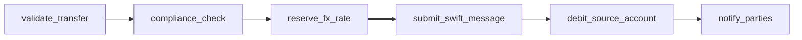

# Cross-border wire transfer

A bank sends 50,000 USD abroad. The transfer goes through six steps, each depending on
the one before. Up to the SWIFT message it can still be called off; once the message is
in the banking network, it cannot.



| Step | What it does | If the saga fails later |
|---|---|---|
| `validate_transfer` | Checks the accounts and the amount | Undone: the validation is cancelled |
| `compliance_check` | Runs the AML/KYC check | Undone: the hold is lifted |
| `reserve_fx_rate` | Locks an exchange rate | Undone: the rate is released |
| `submit_swift_message` | Sends the SWIFT MT103. **The pivot** | Stays: the message is out |
| `debit_source_account` | Debits the sender | No compensation |
| `notify_parties` | Tells the sender, the receiver and compliance | No compensation |

## Run it

It ships with sagaz:

```bash
sagaz examples run wire_transfer
```

You will see each step entered and completed, and this line when the pivot is passed:

```text
Pivot step 'submit_swift_message' completed - ancestors are now tainted
```

## What to look at

**One class is the whole transfer.** The six `@action` methods are the steps, and
`depends_on` puts them in a chain. Reading the class top to bottom tells the business
process.

**The first three steps have a `@compensate`.** If `reserve_fx_rate` fails, the
compliance hold is lifted and the validation cancelled, in that order: the reverse of
how they ran.

**`pivot=True` draws the line.** After `submit_swift_message` completes, the three
steps before it are *tainted*: they will not be undone, whatever fails next. Lifting a
compliance hold makes no sense for a transfer that is already on its way.

**The steps after the pivot have no compensation,** on purpose: there is nothing left
to undo, only work to finish. If `debit_source_account` failed, the saga would end
`partially_committed` and raise `SagaFailedError`: the message is out, the debit is
not done, and someone must act. A `@forward_recovery` handler on that step could retry
it instead; [Points of no return](../tour/pivots.md) shows one.

**Results travel in the context.** `compliance_check` returns a `compliance_id`,
`reserve_fx_rate` an `fx_rate`; later steps read them from `ctx`.

**The simulator stands in for the outside world.** `SWIFTSimulator` plays the banking
network with small delays. In a real service those calls are your HTTP clients.

## The source

??? example "sagaz/examples/banking_finance/finance/wire_transfer/main.py"

    ```python
    --8<-- "sagaz/examples/banking_finance/finance/wire_transfer/main.py"
    ```

## Going further

- [Pivots and forward recovery](../guides/pivots-and-forward-recovery.md): every status and recovery action.
- The [catalogue](shipped.md) marks the 32 shipped examples that have a pivot.
