# CDC with Debezium

Change Data Capture (CDC) streams outbox rows out of PostgreSQL's write-ahead
log (WAL) as they commit, so the outbox worker does not have to poll
`saga_outbox`. This page covers the Debezium source: Debezium's PostgreSQL
connector runs in Kafka Connect, writes every `saga_outbox` insert to a Kafka
topic, and `sagaz.integrations.cdc.debezium.DebeziumKafkaSource` reads that
topic. The design is in [ADR-011](../architecture/adr/adr-011-cdc-support.md);
the issue is #50.

## CDC or polling?

| | Polling (default) | CDC with Debezium |
|---|---|---|
| Latency | Up to the poll interval | Shortly after commit |
| Database load | A claim query every poll, even when idle | The WAL is read once by the replication slot; no queries against `saga_outbox` |
| Moving parts | The worker and PostgreSQL | Also Kafka, Kafka Connect and a replication slot |
| Delivery | At least once | At least once |
| Good fit | Most deployments, low to moderate volume | High event volume, low latency targets, teams already running Kafka |

Stay with polling unless the poll load or latency is a measured problem, or
you already operate Kafka and Kafka Connect. A replication slot is also a new
failure mode for the database (see [Operations](#operations)).

## Architecture

```mermaid
flowchart LR
    app["Saga / application<br/>INSERT INTO saga_outbox"] --> pg[("PostgreSQL<br/>wal_level=logical")]
    pg -- "pgoutput, slot sagaz_outbox,<br/>publication sagaz_outbox_pub" --> dbz["Debezium PostgreSQL connector<br/>(Kafka Connect)"]
    dbz -- "change events (JSON)" --> topic[["Kafka topic<br/>sagaz.public.saga_outbox"]]
    topic -- "consumer group sagaz-cdc" --> src["DebeziumKafkaSource"]
    src -- "CDCChange batches" --> worker["Outbox worker (CDC mode)"]
    worker -- publish --> broker[["Message broker"]]
    worker -. "ack(position):<br/>commit offsets" .-> src
```



1. The application inserts outbox rows in its own transaction, exactly as with
   polling.
2. Debezium decodes the WAL through the `pgoutput` plugin and a replication
   slot, and writes one change event per insert to
   `<topic.prefix>.public.saga_outbox`.
3. `DebeziumKafkaSource` consumes the topic in a consumer group and yields
   `CDCChange` batches; the worker publishes the events and acknowledges each
   batch, which commits the Kafka offsets.

Debezium's own position in the WAL (the slot's confirmed LSN) is tracked by
Kafka Connect; the consumer group's committed offsets are the position of the
sagaz side.

## Setting up Debezium

### Local stack (docker compose)

The root `docker-compose.yaml` has an optional `cdc` profile:

```bash
docker compose --profile cdc up -d
```

It adds:

| Service | Image | Purpose |
|---|---|---|
| `kafka` | `apache/kafka:4.2.2` | Single-node KRaft broker; `kafka:9092` inside the network, `localhost:29092` from the host |
| `connect` | `quay.io/debezium/connect:3.7.1.Final` | Kafka Connect with the Debezium connectors, REST API on `localhost:8083` |
| `connect-register` | same image | One-shot: waits for Connect and registers the outbox connector |

The `postgres` service runs with `wal_level=logical` (required for logical
decoding; without a slot it only adds a little WAL).

The connector creates its publication for `public.saga_outbox`, so the table
must exist before it is registered: initialize the outbox storage
(`PostgreSQLOutboxStorage.initialize()`) first, then re-run the registration
if it failed:

```bash
docker compose --profile cdc up connect-register
curl -s localhost:8083/connectors/sagaz-outbox/status
```

### Connector configuration

The configuration ships with sagaz at
`sagaz/deployment/resources/local/postgres/debezium/saga-outbox-connector.json`:

| Setting | Value | Why |
|---|---|---|
| `plugin.name` | `pgoutput` | Built into PostgreSQL 10+, no server extension needed |
| `table.include.list` | `public.saga_outbox` | Only the outbox is captured |
| `publication.name` / `publication.autocreate.mode` | `sagaz_outbox_pub` / `filtered` | Debezium creates a publication for the included table only |
| `slot.name` | `sagaz_outbox` | One slot per connector; must be unique per database |
| `topic.prefix` | `sagaz` | Topic `sagaz.public.saga_outbox` |
| `snapshot.mode` | `no_data` | Stream from the slot's creation, without re-reading existing rows (see below) |
| `skipped.operations` | `u,d,t` | Status updates, archiving deletes and truncates are not events |
| `tombstones.on.delete` | `false` | No tombstones for deleted rows |
| `heartbeat.interval.ms` | `10000` | Lets the slot advance while the outbox is idle (see [Operations](#operations)) |
| `key.converter`, `value.converter` | `JsonConverter`, `schemas.enable=false` | Schemaless JSON; the source accepts both forms |
| `database.initial.statements` | `SELECT set_config('app.tenant_id', '*', false)` | Lets snapshot queries see every tenant under row-level security (see [Multi-tenancy](#multi-tenancy)) |

With `snapshot.mode=no_data`, rows committed before the slot existed are not
captured: switch the worker to CDC only after the connector is running, and
let the polling worker drain what is already pending. If you choose
`snapshot.mode=initial` instead, snapshot reads (`op = r`) of rows whose status
is no longer `pending` are skipped by the source, so already published events
are not sent again.

### Registering the connector from Python

`sagaz.integrations.cdc.debezium_connect` loads the shipped config, applies
overrides and creates or updates the connector with
`PUT /connectors/<name>/config` (idempotent):

```python
from sagaz.integrations.cdc.debezium_connect import (
    connector_status,
    is_running,
    outbox_connector_config,
    register_connector,
)

config = outbox_connector_config(
    {
        "database.hostname": "db.internal",
        "database.user": "sagaz_cdc",
        "database.password": password,
        "database.dbname": "orders",
        "topic.prefix": "orders",
        "slot.name": "orders_outbox",
    }
)
await register_connector("http://connect:8083", config)  # name defaults to "sagaz-outbox"
assert is_running(await connector_status("http://connect:8083"))
```

Overrides are converted to strings (`True` becomes `"true"`), and `None`
removes a key. Errors (Connect unreachable, configuration rejected) raise
`CDCError`. For production, keep secrets out of the JSON by using a Kafka
Connect config provider (for example `${file:...}` or `${env:...}`) in the
password value.

## `DebeziumKafkaSource`

```python
from sagaz.integrations.cdc.debezium import DebeziumKafkaSource

source = DebeziumKafkaSource(
    "kafka:9092",                # bootstrap servers (str or list)
    topic_prefix="sagaz",        # the connector's topic.prefix
    group_id="sagaz-cdc",        # consumer group = sagaz's position
    max_batch_size=100,          # at most N records per batch...
    max_wait_ms=500,             # ...or whatever arrived within T ms
    consumer_options={           # passed to aiokafka.AIOKafkaConsumer
        "security_protocol": "SASL_SSL",
        "sasl_mechanism": "SCRAM-SHA-512",
        "sasl_plain_username": "sagaz",
        "sasl_plain_password": secret,
    },
)

await source.start()
async for batch in source.changes():
    for change in batch:
        await publish(change.event)       # change.event is an OutboxEvent
    await source.ack(batch[-1].position)  # commits the offsets
await source.stop()
```

It implements the `CDCSource` protocol (`name = "debezium"`, `start`, `stop`,
`changes`, `ack`). Install it with `pip install 'sagaz[cdc]'` (aiokafka and
httpx).

| Argument | Default | Meaning |
|---|---|---|
| `bootstrap_servers` | `localhost:9092` | Kafka brokers |
| `topic_prefix` | `sagaz` | Builds the topic `<prefix>.public.saga_outbox` |
| `topic` | | Overrides the topic name entirely |
| `group_id` | `sagaz-cdc` | Consumer group; every worker of one deployment shares it |
| `max_batch_size` / `max_wait_ms` | `100` / `500` | `getmany` limits per batch |
| `auto_offset_reset` | `earliest` | Where a new group starts, so nothing captured before the first start is missed |
| `consumer_options` | | Extra `AIOKafkaConsumer` arguments (TLS, SASL, client id, ...); `enable_auto_commit` is always forced off |
| `consumer_factory` | aiokafka | `factory(topic, **config)` returning a consumer; for tests |

### What becomes a change

Each Kafka record value is a Debezium change event, with or without the
`{"schema": ..., "payload": ...}` wrapper:

| Record | Result |
|---|---|
| `op = c` (insert) | A `CDCChange` |
| `op = r` (snapshot read) of a `pending` row | A `CDCChange` |
| `op = r` of a row already `sent`, `claimed` or `dead_letter` | Skipped |
| `op = u`, `d`, `t`, `m` | Skipped |
| Tombstone (null value) | Skipped |
| Not JSON, not a change event, or a row that cannot be mapped | Counted as failed, logged, skipped |

The `after` row is mapped by `event_from_row`: `jsonb` columns arrive as JSON
strings, `timestamptz` as ISO-8601 strings (`ZonedTimestamp`), `uuid` as
strings. `CDCChange.committed_at` is the commit time from `source.ts_ms`
(falling back to the event's `ts_ms`), used to measure lag.

`source.stats` counts `received`, `changes`, `skipped` and `failed` records.
A record that is skipped or fails never stops the stream: its offset is
committed with the next acknowledged batch, or right away if no batch is
waiting for an acknowledgement.

The source expects Debezium's default envelope. Do not add the
`ExtractNewRecordState` or `EventRouter` transforms to this connector: the
outbox worker, not Debezium, routes events to their destinations.

## Delivery semantics

`CDCChange.position` is a mapping of Kafka partition to the offset of the last
record handled; the position of a batch's last change covers the whole batch,
including skipped records after it. `ack(position)` commits `offset + 1` for
each of those partitions. Offsets are never committed automatically, so:

- A batch is acknowledged only after the worker has published it.
- If the worker stops or crashes before acknowledging, the batch is consumed
  again by the next consumer of the group (after a restart or a rebalance).
- Debezium itself delivers at least once: after a connector restart it may
  re-send changes from the last flushed LSN.

Delivery is therefore **at least once**, as with polling, and consumers must be
idempotent. Every event carries its `event_id`, so use the
[consumer inbox](../patterns/consumer-inbox.md) to deduplicate on the consumer
side.

Ordering is per Kafka partition. Debezium keys each record by the row's
primary key (`event_id`), so with more than one partition events are only
ordered per event. Keep the topic at one partition (the broker's
`num.partitions` when Kafka auto-creates it; the compose stack uses 1) if the
worker relies on commit order.

## Multi-tenancy

`tenant_id` is an ordinary column of `saga_outbox`, so it travels in the
change event and ends up in `OutboxEvent.tenant_id`; the worker sees every
tenant's events, like the polling worker in the system scope.

Row-level security (ADR-020) and Debezium:

- **Streaming is not filtered by RLS.** Logical decoding reads changes from
  the WAL; RLS policies are applied by the query rewriter to SQL statements,
  and decoding the WAL runs no query against `saga_outbox`. PostgreSQL checks
  the replication role's privileges once when the replication connection
  starts, not for each change record. Every committed insert, of every tenant,
  is streamed.
- **Snapshots are queries and are filtered.** With a snapshot mode that reads
  data, Debezium runs `SELECT` on `saga_outbox` over a regular connection.
  `saga_outbox` uses `FORCE ROW LEVEL SECURITY`, so even the table owner only
  sees the rows the policy admits, and without a tenant setting the policy
  admits only the `default` tenant. The shipped config sets
  `app.tenant_id = '*'` (the system scope) through
  `database.initial.statements` so snapshot queries see every tenant;
  alternatively use a role with `BYPASSRLS` or a superuser.
- PostgreSQL's documentation notes that when the replication role has neither
  `SUPERUSER` nor `BYPASSRLS`, the publisher's row security policies can run
  (during the initial table copy of a subscription) and suggests
  `options=-crow_security=off` for roles that do not trust table owners; with
  that setting an RLS-protected table halts the copy instead. Debezium's
  snapshot is subject to the same rule, hence the system scope above.

The connector's role needs `REPLICATION` and `LOGIN`, `SELECT` on
`saga_outbox` (for snapshots), and, with `publication.autocreate.mode=filtered`,
ownership of `saga_outbox` (PostgreSQL requires the owner to add a table to a
publication) and `CREATE` on the database. To avoid granting ownership,
create the publication once as the owner
(`CREATE PUBLICATION sagaz_outbox_pub FOR TABLE public.saga_outbox;`) and set
`publication.autocreate.mode=disabled`.

## Operations

**Replication slot and WAL retention.** The slot keeps every WAL segment
from its confirmed LSN onwards. If Kafka Connect or the connector is down,
WAL piles up on the database's disk until it comes back, and with no limit
PostgreSQL will eventually run out of disk. Mitigations:

- Set `max_slot_wal_keep_size` (PostgreSQL 13+) so an abandoned slot is
  invalidated instead of filling the disk; the connector must then be
  re-created (and pending rows drained by polling).
- Drop the slot when CDC is retired:
  `SELECT pg_drop_replication_slot('sagaz_outbox');`.
- Keep `heartbeat.interval.ms` on. If the database has much more traffic in
  other tables than in `saga_outbox`, also set `heartbeat.action.query` (an
  update to a small heartbeat table included in the publication) so the slot's
  LSN advances even when no outbox rows are written.

**Monitoring.**

- Slot lag on the database:
  ```sql
  SELECT slot_name, active,
         pg_size_pretty(pg_wal_lsn_diff(pg_current_wal_lsn(), confirmed_flush_lsn)) AS lag
  FROM pg_replication_slots WHERE slot_name = 'sagaz_outbox';
  ```
  Alert when `active` is false or the lag keeps growing.
- Connector health: `GET /connectors/sagaz-outbox/status` (or
  `connector_status()`); a `FAILED` task needs a restart
  (`POST /connectors/sagaz-outbox/restart?includeTasks=true`).
- Consumer lag of the `sagaz-cdc` group on `sagaz.public.saga_outbox`
  (`kafka-consumer-groups.sh --describe --group sagaz-cdc`).
- `DebeziumKafkaSource.stats.failed`: records the source could not decode.
- Debezium's JMX metrics (`MilliSecondsBehindSource`, `QueueRemainingCapacity`).

**Failover.** A logical slot lives on the primary. Before PostgreSQL 17 it is
not carried over to a promoted standby; on 17+ use failover slots
(`failover = true` and `sync_replication_slots`). After a failover without the
slot, re-create the connector and let the polling worker cover the gap.

## Running the CDC worker

> **Placeholder:** how to run the outbox worker in CDC mode with
> `DebeziumKafkaSource` (CLI flags, configuration and deployment) will be
> documented here.

## Metrics

> **Placeholder:** the CDC worker's metrics (lag from `committed_at`, batch
> sizes, skipped and failed records) will be documented here.
