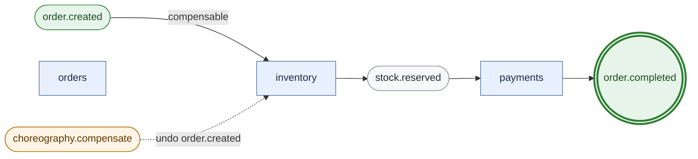

# Saga choreography

In **orchestration** (sagaz's `Saga`), one coordinator runs the steps and, on
failure, the compensations. In **choreography**, there is no coordinator: each
service reacts to events and publishes its own, and a failure makes every service
undo its part. Design: [ADR-029](../architecture/adr/adr-029-saga-choreography.md);
issue #56.

## Orchestration or choreography?

| | Orchestration (`Saga`) | Choreography (`ChoreographedSaga`) |
|---|---|---|
| Control flow | One place defines the order of steps | Emerges from which service reacts to which event |
| Coupling | The orchestrator knows every service | Services only know event types |
| Failure handling | The orchestrator runs compensations in reverse | Each service undoes its own actions when told to compensate |
| Visibility | The saga's state is one record | Reconstructed from events by a tracker |
| Adding a step | Change the saga definition | Add a service subscribed to an event |
| Good fit | A workflow owned by one team; strict ordering; easy reasoning | Independent services owned by different teams; high fan-out; loose coupling |

Start with orchestration. Choreography pays off when no single team should own the
whole flow, but it is harder to follow, so use the tracker.

## A choreographed order

```python
from sagaz.choreography import ChoreographedSaga, Event, compensate, on_event


class Inventory(ChoreographedSaga):
    @on_event("order.created")
    async def reserve(self, event: Event) -> None:
        await stock.reserve(event.data["order_id"])
        await self.emit("inventory.reserved", event.data)

    @compensate("order.created")
    async def release(self, event: Event) -> None:
        await stock.release(event.data["order_id"])


class Payments(ChoreographedSaga):
    @on_event("inventory.reserved")
    async def charge(self, event: Event) -> None:
        await gateway.charge(event.data["order_id"], event.data["amount"])  # may raise
        await self.emit("payment.charged", event.data)

    @compensate("inventory.reserved")
    async def refund(self, event: Event) -> None:
        await gateway.refund(event.data["order_id"])


class Shipping(ChoreographedSaga):
    @on_event("payment.charged")
    async def ship(self, event: Event) -> None:
        await self.emit("order.shipped", event.data)
```

Each service runs an engine on its bus:

```python
from sagaz.choreography import ChoreographyEngine, create_event_bus

bus = create_event_bus("kafka")            # or "redis" (Redis Streams), "rabbitmq", "memory"
engine = ChoreographyEngine(bus, completion_events={"order.shipped"})
engine.register(Inventory())
await bus.start()
await engine.start()
```

A transaction starts with `begin()`, which gives it a new correlation id:

```python
orders = ChoreographedSaga(name="orders")
engine.register(orders)
await orders.begin("order.created", {"order_id": "o-1", "amount": 40}, tenant="acme")
```

Give your own `correlation_id` (a request id, an order id) to make `begin` safe to
retry: a correlation id runs once per tenant, as a saga id does with `Saga.run`. A
second `begin` with it raises `SagaAlreadyExistsError` before anything is published;
`allow_rerun=True` starts the transaction anyway. The record is kept with the
participant state's handled deliveries, so it lasts as long as they do (see `prune`).
Participant names starting with `__sagaz_` are reserved.

### Without a subclass

The same participants can be built with `on()`, the counterpart of `Saga.add_step()` for
orchestration. A handler and its compensation receive the event and the participant,
which is how they publish their result:

```python
from sagaz.choreography import ChoreographedSaga, Event


async def reserve(event: Event, inventory: ChoreographedSaga) -> None:
    await stock.reserve(event.data["order_id"])
    await inventory.emit("inventory.reserved", event.data)


async def release(event: Event, inventory: ChoreographedSaga) -> None:
    await stock.release(event.data["order_id"])


inventory = ChoreographedSaga(name="inventory").on("order.created", reserve, compensation=release)
engine.register(inventory)
```

`on()` returns the participant, so calls chain. Handlers may be sync or async. A
participant uses one style: `on()` on a class with `@on_event` handlers raises
`SagaDefinitionError`, as do two handlers for one event type (in either style) and an
`on()` after `engine.register()`, which subscribes to the event types it knows then.

## What travels with an event

| Field | Set by | Meaning |
|---|---|---|
| `saga_id` / `correlation_id` | `begin()`, inherited by `emit()` | The business transaction |
| `tenant_id` | `begin()` (default: the current tenant scope), inherited | The tenant (ADR-020). Handlers run in that tenant's scope |
| `causation_id` | `emit()` | The `event_id` of the event being handled |
| `source` | `begin()` / `emit()` | The participant that published the event |
| `trace_context` | `begin()` / `emit()` / the engine's reports | The W3C trace context of the span that published the event (empty without OpenTelemetry) |
| `lineage` | `emit()` | The actions the event descends from: one `(event_id, participant)` per hop, the event handled and the participant that handled it. The last hop is `(causation_id, source)`. It tells which actions led to a [pivot](#pivots), and grows by one hop per step |

`emit()` only works inside a handler, because it continues that handler's
transaction. Use `begin()` to start one. Events published directly on the bus keep
whatever fields you set.

## Failure and compensation

### Retries and timeouts

A handler that raises is retried, as an orchestrated step is: it runs up to 4 times
(3 retries), each attempt limited to 60 seconds, with exponential backoff between
attempts. Set them per handler, or for every handler on the engine:

```python
@on_event("inventory.reserved", max_retries=5, timeout_seconds=10)
async def charge(self, event: Event) -> None: ...

participant.on("inventory.reserved", charge, max_retries=5, timeout_seconds=10)
engine = ChoreographyEngine(bus, default_max_retries=3, default_timeout=60.0)
```

> **Since 2.6.0 handlers are retried by default.** Before, a handler ran once. A
> handler with an external effect that is not idempotent (charging a card without an
> idempotency key, sending an email) can now run up to 4 times when it fails: make it
> idempotent, or give it `max_retries=0`.

Compensations are retried the same way; `@compensate(..., max_retries=,
timeout_seconds=)` overrides the engine's defaults.

### Compensation

When a handler still raises after its retries, the engine publishes a `choreography.compensate` event with
the failing participant, the event it was handling and the reason. Every
participant receives it, runs its `@compensate` methods for the actions it
completed **in that transaction**, newest first, and reports with
`choreography.compensated`. The failed action itself is not compensated, because it
never completed.

An action counts as completed once its handler emits its result, or returns. Use
`completion_events` so that participants can forget a finished transaction. Each
participant also caps what it remembers (`max_tracked_transactions`, 10,000 by
default).

Once a participant has compensated a transaction, it ignores that transaction's
business events: they are counted with `outcome="after_compensation"` and logged, but
their handlers do not run. A late event can come from another partition, a
redelivery or a slow producer. Without this rule it would perform an action that
nothing will undo. With it, compensating before or after an event leads to the same
state: compensation is commutative, as distributed sagas require. Each participant
remembers its last `max_tracked_transactions` compensated transactions.

You can still model failures as domain events, for example a `payment.failed`
handled with `@on_event` as in ADR-029. The engine adds the generic path for
unexpected errors.

### Pivots

Some actions cannot be undone: a payment captured, a parcel handed to a carrier. Mark
their handler as a **pivot**, a point of no return:

```python
class Payments(ChoreographedSaga):
    @on_event("stock.reserved", pivot=True)
    async def charge(self, event: Event) -> None:
        await capture(event.data["order_id"])
        await self.emit("payment.captured")

payments.on("stock.reserved", charge, pivot=True)      # without a subclass
```

Once a pivot handler completes, a later failure no longer undoes what led to it:

1. The participant publishes `choreography.pivoted` when the handler emits its result,
   or returns. That is before anything the pivot causes.
2. Every participant receives it and remembers it. The notice's `lineage` names every
   action the pivot descends from: which participant handled which event.
3. A later `choreography.compensate` leaves those actions done: the pivot's
   **ancestors**, exactly as in an orchestrated saga. Everything else is undone as
   usual: what followed the pivot, and a branch beside it, even one that handled the
   same event as the pivot. The pivot's own action is never compensated, even if it
   has a `@compensate` method.
4. Each `choreography.compensated` report lists what was kept (`kept`), next to `undone`
   and `failed`, and the tracker reports the transaction as `partially_committed`.

In the order example, if shipping fails after `charge`: the stock stays reserved, the
payment stays captured, a label printed after the payment is cancelled, and the
transaction ends `partially_committed`. Someone must act on it: nothing recovers it
forward on its own ([#665](https://github.com/brunolnetto/sagaz/issues/665)).

What to know:

- **The notice must arrive before the request to compensate.** It is published before
  anything the pivot causes, so a bus that delivers a transaction's events in order
  keeps the rule. A request to compensate that was already under way when the pivot
  completed (another branch failed at the same moment, or a deadline expired) may have
  undone an earlier action already: nothing coordinates the participants. Give the
  pivot's transaction a deadline that leaves it time to finish.
- **A participant is its `name`, not a process.** The lineage names participants by
  `name`, the key their state uses too: see [Who a participant is](#who-a-participant-is).
- **Every service must carry the lineage.** It travels in the event envelope
  (see [What travels with an event](#what-travels-with-an-event)). An event from a
  producer older than 2.6.0, or one built by hand without `caused_by`, has none, and
  the actions before it are not recognised as ancestors: they are undone. sagaz tells
  you when it happens: a participant that receives an event with a cause and no lineage
  leading to it logs a warning, once per producer, and counts it in
  `sagaz_choreography_events_without_lineage_total`. Watch that metric while services
  are upgraded one by one; it should stay at zero afterwards.
- **A pivot needs a durable state.** An engine that starts with a pivot participant and
  its state in memory logs a warning: after a restart, or in another replica, the
  participant does not know what led to the pivot.

## Delivery guarantees

Buses deliver at least once, so the engine deduplicates deliveries by `event_id`, per
participant (in memory, bounded to the last 100,000 deliveries, unless a durable state is
configured). While a handler runs, its delivery is reserved: a duplicate arriving
meanwhile is dropped. Once the handler succeeded, or failed and the compensation
request was published, the delivery is done for good and every later copy is dropped.
If the process dies in the handler, the reservation expires and the broker's
redelivery is handled then. A reservation lasts long enough for all the handler's
attempts (`(max_retries + 1) * timeout_seconds`, the backoffs and a minute; an hour for
a handler without a timeout); set it with `ChoreographyEngine(delivery_lease=seconds)`.
A redelivery before it expires is dropped, so a broker that redelivers only once may
need a longer redelivery delay or a shorter lease.
Handlers that call external systems should still be idempotent: a handler that died
after its external effect runs again. Without a durable state, the deduplication only
holds for the lifetime of the process.

Within one transaction, the buses deliver events in the order they were published:

| Bus | Ordering |
|---|---|
| Kafka | Per transaction. Events are keyed by correlation id, so a transaction's events share a partition. Events without one are keyed by type. |
| Redis Streams | Per stream: the whole topic is one ordered stream. |
| RabbitMQ | Per queue, with a single consumer per queue. |
| In-memory | Nested and depth-first: an event published by a handler is delivered before the handler returns. |

There is no ordering between different transactions. Participants still handle a
`choreography.compensate` that overtakes a business event correctly (see above).

## Deadlines

In orchestration, the coordinator times out a step. In choreography, nobody owns time
unless you give it an owner. Give a deadline to the participant that starts the
transaction:

```python
await orders.begin("order.created", data, deadline=30)   # seconds, or a timedelta
```

If no completion event (`completion_events`) arrives in time, that participant's engine
publishes `choreography.compensate` with `reason="deadline exceeded"`, and every
participant undoes its part. A completion or a compensation clears the deadline. Events
that arrive after the deadline hit the compensation tombstone and are not acted on.

The engine checks deadlines every `deadline_poll_interval` seconds (default 1). With a
durable state, deadlines survive restarts and replicas share them. A replica claims an
expired deadline for `deadline_lease` seconds (default 60) before publishing, so one
replica compensates. If it dies before the compensation is handled, another replica
publishes again after the lease. A second `choreography.compensate` is harmless:
participants have nothing left to undo. With the in-memory state, deadlines are lost
on restart.

The tracker can also report transactions that have stopped moving, without
compensating them:

```python
tracker = ChoreographyTracker(bus, storage=saga_storage, stall_after=300)
```

```bash
sagaz choreography status <correlation-id> --stall-after 300
```

An executing transaction with no event for `stall_after` seconds is reported as
`stalled`. The status is computed when it is read and never stored.

## On the unified saga log

`ChoreographyEngine(bus, saga_log="postgresql://...")` keeps participant state on the
unified saga log (ADR-041). Each published event is then written to the log and to an
outbox in the same database transaction as the state change, and `engine.relay`
publishes the outbox. A crash can no longer lose the state change or the event. See
[Unified saga log](../guides/unified-saga-log.md#choreography-on-the-log).

## Durable participant state

A participant remembers which of its actions it may have to compensate, the
transactions it finished or compensated, and the deliveries it already handled. By
default this lives in the participant's memory, so a participant that restarts forgets
what to compensate and may handle a redelivered event again. Replicas of a participant
also do not see each other's actions: the replica that receives
`choreography.compensate` can only undo its own.

Give the engine a durable state to remove both limits:

```python
engine = ChoreographyEngine(bus, completion_events={"order.shipped"},
                            state="postgresql://...")   # or sqlite://<path>, or a ParticipantState
```

Every replica of a participant (same `name`) shares its state, separated by tenant
(row-level security in PostgreSQL). In PostgreSQL, recording an action and ending its
transaction are serialized per transaction, so an action is never recorded after
compensation started. A delivery is reserved while its handler runs, so that a replica
receiving a copy meanwhile drops it; if the process crashes during the handler, the
reservation expires and the redelivery is handled (see [Delivery guarantees](#delivery-guarantees)).
Finished transactions and handled deliveries accumulate. Delete old ones
with `await state.prune(timedelta(days=7))`. The in-memory state bounds itself instead.

## Who a participant is

A participant is its **`name`**, not a process, a host or an address. Its state is kept
under the name, and the `lineage` of events names it. So replicas of a service share the
name, and scaling out, restarts, load balancers and changing addresses do not matter, as
long as the replicas share a [durable state](#durable-participant-state): the replica
that receives a request to compensate is rarely the one that acted.

That makes two rules, and sagaz guards each:

**A name stays.** A participant renamed while transactions are in flight would no longer
find its actions, nor recognise itself in a lineage. Tell it the names it had:

```python
ChoreographedSaga(name="billing", formerly=["payments"])
```

It compensates what it did under any of these names, and remembers the transactions it
compensated under them. New actions are recorded under the current name. Drop a former
name in a later deploy, once no transaction that started under it is still open.
Handled deliveries and deadlines are kept under the name of the moment: an event
redelivered across the rename may be handled again.

**A name belongs to one service.** Two services using one name would share their state
and be taken for each other.

- An engine refuses a second participant that answers to a name already registered
  (`SagaDefinitionError`).
- Across services, give each engine the `service` it runs in, the same for all its
  replicas:

  ```python
  engine = ChoreographyEngine(bus, service="billing")
  ```

  When it starts, the engine announces its participants on the bus
  (`choreography.participant`). An engine that hosts one of these names for another
  service logs an error, lists it in `engine.identity.conflicts`, and announces its own
  again, so both sides learn of it whichever started first. Replicas of one service do
  not conflict. The check is a report, not a lock: the engines keep running, and it
  only sees engines connected to the bus at the same time.

Names and lineages are what each participant declares: sagaz does not sign events.
Whoever can publish on the bus can publish a `choreography.compensate` or a
`choreography.pivoted`. Restrict who can publish with the broker's own access control.

## Tenants

A participant handles an event in the tenant the event names (`Event.tenant_id`). With
a tenant registry, it checks that tenant first, as an orchestrated saga does
([Multi-tenancy](../guides/multi-tenancy.md#registry-and-quotas)):

```python
engine = ChoreographyEngine(bus, tenant_registry=registry)  # default: SagaConfig.tenant_registry
```

| Tenant | `begin()` | A delivered event |
|---|---|---|
| Not registered | Raises `TenantNotFoundError` | Not handled: the participant publishes `choreography.compensate` with the reason |
| Suspended | Raises `TenantSuspendedError` | Not handled, compensated the same way |
| Over `max_concurrent_sagas` | Raises `QuotaExceededError` | Waits for a slot |

- **Before anything else:** `begin()` checks the tenant before it claims the correlation
  id or publishes, so a refused call can be retried with the same id.
- **Compensation always runs:** compensation events are never refused nor queued, even
  for a tenant suspended meanwhile, so a transaction can always be undone.
- **What `max_concurrent_sagas` counts:** the tenant's transactions this process is
  handling at once. All the deliveries of one transaction in a process share one slot,
  so nested in-process handlers cannot deadlock. The slots are those of orchestrated
  sagas, so one quota covers both modes.
- **Caps:** `max_retries` and `max_step_duration_seconds` cap handlers and
  compensations, as they cap orchestrated steps.

Without a registry, an event runs for the tenant it names, with no quotas. A registry
checks that a tenant exists and may run; it does not authenticate the publisher. Who may
publish an event for a tenant is the bus's access control.

## Status of a transaction

`ChoreographyTracker` subscribes to every event and builds each transaction's status
from the events alone:

| Status | Meaning |
|---|---|
| `executing` | Events seen, no failure, no completion event yet |
| `stalled` | Executing, but no event for `stall_after` (reported only when the tracker has `stall_after`) |
| `completed` | A completion event was seen |
| `compensating` | A participant failed; not every participant that emitted events has reported compensation |
| `rolled_back` | Every participant that emitted events (other than the failed one) reported compensation |
| `partially_committed` | The same, after a [pivot](#pivots) completed: what led to the pivot stays done |
| `failed` | A compensation itself raised |

The status does not depend on the order events arrive in. Run **one** tracker with a
saga storage so that other processes can read it:

```python
from sagaz.choreography import ChoreographyTracker

tracker = ChoreographyTracker(bus, storage=saga_storage, completion_events={"order.shipped"})
await tracker.start()
```

```bash
sagaz choreography status <correlation-id> --tenant acme --storage-url postgresql://...
sagaz choreography status <correlation-id> --events      # every event seen
sagaz choreography status <correlation-id> --json
```

## Diagram

`engine.to_mermaid()` draws the registered participants as a Mermaid flowchart, as
`to_mermaid()` does for an orchestrated saga. `to_mermaid_markdown()` wraps it in a
fenced block, and `choreography_mermaid(participants, completion_events=...)` draws
participants without an engine.

The graph has these nodes and edges:
- **Handling:** an edge from each event type to the participants that handle it, marked
  `compensable` when the participant can undo it.
- **Emitting:** an edge from a participant to each event type its handler declared it
  emits.
- **Completion:** completion events are final nodes.
- **Compensation:** `choreography.compensate` reaches every participant that can undo
  something (`show_compensation=False` hides it).

What a handler emits is only known at run time unless it is declared, with `emits=`:

```python
inventory.on("order.created", reserve, release, emits={"stock.reserved"})

@on_event("stock.reserved", emits={"order.completed"})
async def pay(self, event): ...
```

A handler without `emits=` is drawn with the note `emits undeclared on <event>`. Once
every handler declared what it emits, the events nobody emits are drawn as entry
points. A handler that emits a type it did not declare still publishes it, and the
participant logs a warning, because the diagram is then wrong.



The diagram shows one engine's participants. A choreography spread across services is
drawn whole from its shared definition and map ([#626], [#627], in 2.7.0).

## Analytics

With `sagaz[analytics]`, the analytics pipeline reads the tracker's records from the
same saga storage and reports on choreographed transactions:

```python
from sagaz.analytics import SagaAnalyticsPipeline, SagaQueries
from sagaz.core.tenant import system_scope

with SagaAnalyticsPipeline(saga_storage) as pipeline:
    with system_scope():                       # every tenant
        await pipeline.run()
    pipeline.query(SagaQueries.CHOREOGRAPHY_SUMMARY)       # per flow: outcomes, compensation rate, durations
    pipeline.query(SagaQueries.CHOREOGRAPHY_PARTICIPANTS)  # failures caused, actions undone, compensation failures
    pipeline.query(SagaQueries.CHOREOGRAPHY_HOP_LATENCY)   # p50/p95/p99 from cause to effect, per participant
    pipeline.query(SagaQueries.CHOREOGRAPHY_FAILURES)      # where and why transactions fail
```

A transaction's **flow** is the type of its first business event, such as
`order.created`. **Hop latency** is the time from an event to the event a participant
published in response: handling plus bus delivery. `sagaz monitor --storage-url ...`
serves the same reports at `/api/v1/analytics/choreography*`.

## Metrics

| Metric | Labels |
|---|---|
| `sagaz_choreography_events_total` | `participant`, `event_type`, `outcome` (`handled`, `failed`, `duplicate`, `after_compensation`) |
| `sagaz_choreography_handler_seconds` | `participant`, `event_type` |
| `sagaz_choreography_compensations_total` | `participant`, `outcome` (`undone`, `failed`, `kept` by a pivot) |
| `sagaz_choreography_events_without_lineage_total` | `participant`, `source` (the producer). Events delivered with a cause and no lineage leading to it: a producer older than 2.6.0, see [Pivots](#pivots) |
| `sagaz_choreography_deadlines_expired_total` | `participant` |

## Tracing and listeners

With `opentelemetry` installed, every handler and every compensation runs in a span,
and each event carries the trace context of the span that published it. So a
transaction is **one trace**, across participants and services: `begin()` opens it
(a child of your current span, if any), each handler's span is a child of the span
that published its event, and the events a handler emits continue from there. A
failed handler's span is an error, and the compensation it causes is its child:

```text
orders begin order.created
└── inventory handle order.created
    └── payments handle stock.reserved        ✗ card declined
        └── inventory compensate transaction choreography.compensate
            └── inventory compensate order.created
```

Spans are named `<participant> <operation> <event type>` and carry
`sagaz.participant`, `sagaz.event_type`, `sagaz.event_id`, `sagaz.correlation_id`
and `sagaz.tenant_id`. Their instrumentation scope is `sagaz.choreography`, and they
go to the global tracer provider you configure.

The listeners of orchestrated sagas work too, at two levels, because in a
choreography no participant sees the whole transaction: each one knows its own
steps, and only an observer of every event knows how the transaction ended.

```python
from sagaz.choreography.tracker import ChoreographyTracker
from sagaz.core.listeners import LoggingSagaListener, MetricsSagaListener

# What each participant on this engine does: its steps and compensations.
engine = ChoreographyEngine(bus, listeners=[LoggingSagaListener()])
# How each transaction ends: once per transaction, whatever the participants.
tracker = ChoreographyTracker(bus, completion_events={"order.completed"},
                              listeners=[MetricsSagaListener()])
```

| Hook | Called by | When |
|---|---|---|
| `on_step_enter` / `_success` / `_failure` | The engine | A handler runs, succeeds, or still raises after its retries. The saga name is the participant, the step is the event type |
| `on_compensation_start` / `_complete` / `_failed` | The engine | Each of the participant's compensations |
| `on_saga_start` | The tracker | It first records the transaction |
| `on_saga_complete` | The tracker | The transaction becomes `completed` |
| `on_saga_failed` | The tracker | It becomes `rolled_back` or `failed`; the error carries the failing participant's reason |

The tracker's hooks use the saga name `choreography`. Their `ctx` holds the correlation
id, the tenant, `initiators` (the participants that started it), `participants` and
`status`. Run one tracker: two would each tell their listeners.

Listeners run on the hot path: a handler, or the tracker's observation of an event,
waits for them. A listener that raises is logged and ignored, and an async listener
call that takes longer than `listener_timeout` seconds (an engine and tracker
argument, default 5) is cancelled, logged and skipped. Keep listeners quick, and hand
slow work (an HTTP call, a write to another system) to a queue of your own.

On the in-memory `EventBus`, wildcard subscribers such as the tracker run before an
event's handlers, so they see each event before its effects. Across services, events
of one transaction can still arrive out of causal order ([#628]).

## Performance

With the in-memory bus on a laptop, the engine dispatched about 24,800 events/s with
a p99 of 0.07 ms per delivery, including deduplication, tenant scoping and metrics
(`tests/integration/test_choreography_performance.py`, marker `performance`). Over a
real broker, the broker's own latency dominates.

[#628]: https://github.com/brunolnetto/sagaz/issues/628
[#626]: https://github.com/brunolnetto/sagaz/issues/626
[#627]: https://github.com/brunolnetto/sagaz/issues/627
