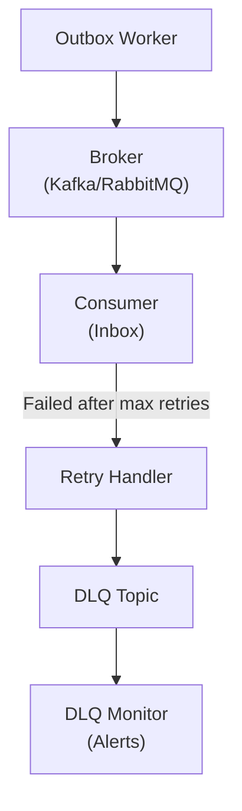

# Dead Letter Queue (DLQ) Pattern

## Overview

The Dead Letter Queue pattern handles messages that cannot be processed
successfully after multiple retry attempts.  Instead of losing these
messages, they are moved to a separate queue for later analysis and
reprocessing.

## OutboxEvent DLQ fields

After an event is moved to the DLQ, two additional fields are populated
on the `OutboxEvent` dataclass:

| Field | Type | Description |
|-------|------|-------------|
| `dead_letter_at` | `datetime \| None` | UTC timestamp of when the event was dead-lettered |
| `dead_letter_reason` | `str \| None` | The last error message or `"max_retries_exceeded"` |

These fields are included in `to_dict()` / `from_dict()` so they round-trip
correctly through all storage backends.

## Prometheus metric

| Metric | Type | Description |
|--------|------|-------------|
| `sagaz_dlq_depth` | Gauge | Current number of events sitting in the DLQ |

The gauge is incremented each time `OutboxWorker._move_to_dead_letter` fires
and should be scraped alongside the existing outbox counters.

## Architecture



## Configuration

### Retries before the DLQ

The outbox worker retries each event that fails to publish, and moves it to the dead
letter state after `OutboxConfig.max_retries` failed attempts (default 10):

```python
from sagaz.core.outbox import OutboxConfig, OutboxWorker

config = OutboxConfig(
    max_retries=5,               # attempts before DEAD_LETTER
    poll_interval_seconds=1.0,
    claim_timeout_seconds=300,   # a claimed event older than this is retried
)
worker = OutboxWorker(storage=outbox_storage, broker=broker, config=config)
```

The worker reads the same settings from the environment (`OUTBOX_MAX_RETRIES`, …)
with `OutboxConfig.from_env()`.

### What a dead-lettered event records

Each failure classifies the error and fingerprints its message, so the DLQ can be
grouped by cause:

```python
from sagaz.core.outbox.error_classifier import classify_error, create_error_fingerprint

classify_error(ConnectionError("refused"))     # "TRANSIENT": worth retrying
classify_error(ValueError("bad payload"))      # "PERMANENT": will not succeed on retry
create_error_fingerprint("Connection refused to 10.0.0.5:5432")  # same for any host/port
```

The classification is recorded on the event (`error_classification`,
`error_fingerprint`, `error_type`) alongside the DLQ fields above; it does not change
the number of retries.

## Handling DLQ Events

### Manual review

The outbox storage reads, re-queues and purges dead-lettered events:

```python
dead = await outbox_storage.get_dead_letter_events(limit=100)
for event in dead:
    print(event.event_id, event.event_type, event.error_classification, event.dead_letter_reason)

# Fixed the cause (a broker ACL, a consumer bug)? Put the event back in the queue:
await outbox_storage.requeue_dead_letter_event(dead[0].event_id)
```

The [recovery commands](#recovery-commands) below do the same from the shell.

### Grouping by cause

Group dead-lettered events by `error_fingerprint` to tell one broken dependency
(hundreds of events, one fingerprint) from scattered bad payloads, and re-queue a
group once its cause is fixed:

```python
from collections import Counter

dead = await outbox_storage.get_dead_letter_events(limit=1000)
by_cause = Counter((e.error_classification, e.error_fingerprint) for e in dead)
```

## Monitoring

### Prometheus Metrics

```python
# Automatically exposed by sagaz
sagaz_dlq_messages_total{topic="saga_events_dlq", error_type="DatabaseError"}
sagaz_dlq_processing_duration_seconds{action="republish"}
sagaz_dlq_queue_depth{topic="saga_events_dlq"}
sagaz_dlq_oldest_message_age_seconds{topic="saga_events_dlq"}
```

### Grafana Dashboard

```json
{
  "title": "DLQ Monitoring",
  "panels": [
    {
      "title": "DLQ Message Rate",
      "query": "rate(sagaz_dlq_messages_total[5m])"
    },
    {
      "title": "DLQ Queue Depth",
      "query": "sagaz_dlq_queue_depth"
    },
    {
      "title": "Oldest DLQ Message Age",
      "query": "sagaz_dlq_oldest_message_age_seconds"
    },
    {
      "title": "DLQ by Error Type",
      "query": "sum by (error_type) (sagaz_dlq_messages_total)"
    }
  ]
}
```

## AlertManager Integration

See [AlertManager Rules](../monitoring/alertmanager-rules.yml) for DLQ-specific alerts.

## Best Practices

### 1. Classify Errors

```python
# Retryable (transient)
RETRYABLE = [
    "ConnectionError",
    "TimeoutError", 
    "TransientDatabaseError",
    "RateLimitExceeded",
]

# Non-retryable (permanent)
NON_RETRYABLE = [
    "ValidationError",
    "InvalidSchemaError",
    "AuthenticationError",
    "BusinessRuleViolation",
]
```

### 2. Set Appropriate Retention

```yaml
# Kafka topic config
saga_events_dlq:
  retention.ms: 604800000  # 7 days
  cleanup.policy: delete
```

### 3. Monitor DLQ Depth

- Alert when DLQ has > 0 messages
- Alert when DLQ grows faster than processing
- Alert when messages older than 24 hours exist

### 4. Implement Backpressure

```python
# Pause main queue if DLQ is too deep
if dlq_depth > 1000:
    await pause_main_consumer()
    await notify_oncall("DLQ overflow - pausing consumers")
```

### 5. Document Recovery Procedures

For each error type, document:
1. Root cause identification
2. Fix procedure
3. Replay command
4. Verification steps

## Recovery Commands

The `sagaz dlq` command group provides full DLQ management once a
project's storage backend is configured.

### List DLQ events

```bash
# Show the first 100 DLQ events (table format)
sagaz dlq list

# Increase the limit or switch to JSON
sagaz dlq list --limit 500 --format json
```

### Replay (re-queue) events

```bash
# Re-queue a single event by ID
sagaz dlq replay --id <event-id>

# Re-queue every event currently in the DLQ
sagaz dlq replay --all
```

### Purge DLQ (permanent removal — use with caution)

```bash
# Remove events older than 7 days (interactive confirmation required)
sagaz dlq purge --older 7d

# Remove all DLQ events
sagaz dlq purge
```

## Related Documentation

- [ADR-011: CDC Support](../architecture/adr/adr-011-cdc-support.md)
- [AlertManager Rules](../monitoring/alertmanager-rules.yml)
- Outbox Pattern
